<!-- Animated typing subtitle -->

 

<!-- Animated ASCII terminal (local SVG, animates on GitHub) -->

  

---

### About

I'm a Computer Science student exploring how **AI, robotics, and embedded systems** can solve real-world problems. I enjoy taking ideas from experiments to working applications, whether that means building data-driven models, developing autonomous systems, or shipping software.

- **Currently learning:** Embedded systems, robotics, computer vision, and data science.
- **Focused on:** Machine learning, intelligent systems, and practical software engineering.
- **Also interested in:** Web development, applied research, and hackathons.
- **Reach me:** [lazyyeou@gmail.com](mailto:lazyyeou@gmail.com)

### Tools & Technologies

<!-- Hover over the icons on skillicons.dev for names; grouped by domain -->
<table>
  <tr>
    <td align="center"><b>Languages</b></td>
    <td>
      
    </td>
  </tr>
  <tr>
    <td align="center"><b>AI & Data Science</b></td>
    <td>
      
    </td>
  </tr>
  <tr>
    <td align="center"><b>Web, Apps & Embedded</b></td>
    <td>
      
    </td>
  </tr>
</table>

### GitHub Analytics

<!-- Generated daily by .github/workflows/update-stats.yml. Set the PROFILE_STATS_TOKEN Actions secret to a personal access token for public repository statistics, then start a new workflow run on main. -->

  

<!-- Animated contribution activity graph -->

### What I'm Exploring

| Area | Interests |
| --- | --- |
| **Robotics & Embedded** | UAVs, ROS 2, sensor integration, onboard vision |
| **AI & Data Science** | Machine learning, computer vision, model evaluation, Kaggle |
| **Software Engineering** | Full-stack applications, APIs, developer workflows |

---

